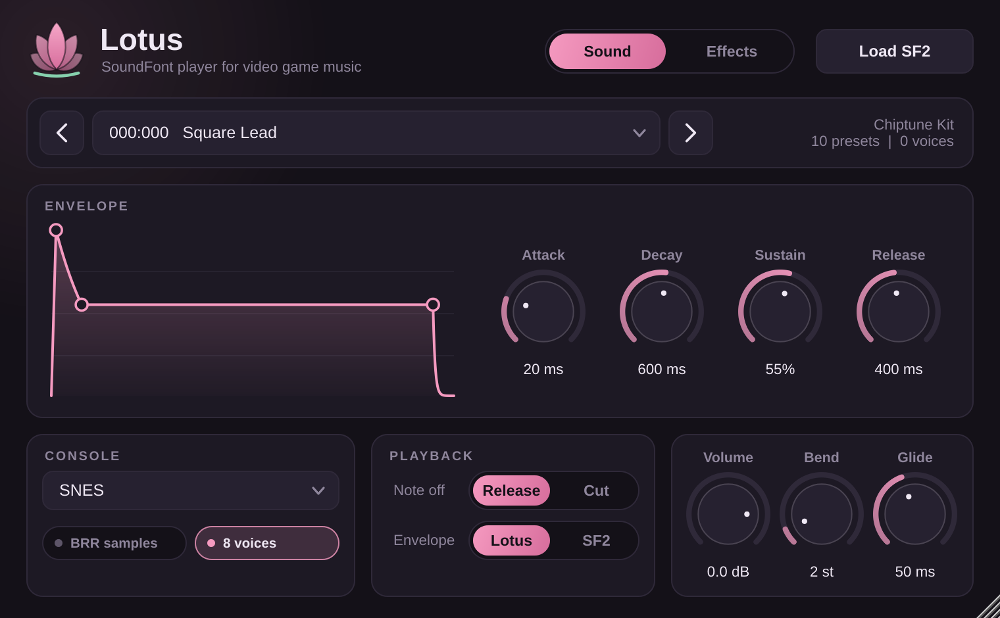
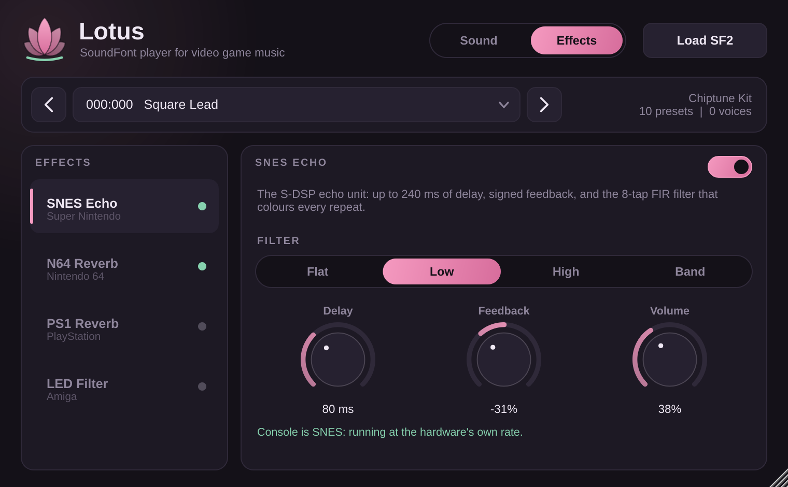

# Lotus

Lotus is a SoundFont (`.sf2`) player for making video game music. Release at 0 means the note stops, and you can play your samples through models of the sound hardware in the SNES, N64, PlayStation, Mega Drive, Amiga and other machines.



Formats: **CLAP**, **VST3** and **Standalone** on Windows, macOS and Linux, plus **AU** on macOS and **LV2** on Linux.

## What it does

- **ADSR.** A 250 ms release lasts 250 ms and 0 stops the note dead. The SoundFont's own envelopes only apply if you switch to them.
- **Cut mode.** One switch makes notes stop the moment you let go of the key, even with the SoundFont's envelopes. With the sustain pedal down, the cut happens when the pedal comes up.
- **Console playback.** Pick a console and Lotus copies its mixer rate, interpolation, pitch precision, bit depth and output filtering.
- **Native sample formats.** Optionally hear your samples after conversion to the console's own format (BRR on SNES, ADPCM on PS1/PS2, IMA-ADPCM on DS, DPCM on NES).
- **Hardware voice limits.** Optionally cap polyphony at the console's voice count, so the SNES gets 8, the Amiga 4 and the NES DMC 1. Extra notes steal the oldest.
- **Console effects.** SNES echo, N64 reverb, PS1 reverb and the Amiga LED filter, on their own tab.
- **Glide**, pitch-bend range, MIDI program changes, drag and drop, a scalable window.

## Consoles

| Console | Mixer rate | Interpolation | Pitch | Output |
| --- | --- | --- | --- | --- |
| Modern / Linear / Raw | project rate | Hermite / linear / none | exact | float |
| NES | project rate | none (DMC) | 16 fixed DMC rates | 7-bit, 90 Hz + 440 Hz high-pass, 14 kHz low-pass |
| SNES | 32 kHz | 4-tap Gaussian (S-DSP table) | 4.12 fixed point, about 2 octaves up | 16-bit |
| N64 | 32 kHz | 4-tap, 64-phase polyphase (RSP table) | Q1.15, at most one octave up | 16-bit |
| GBA | 13.379 kHz | linear | exact | 8-bit, held |
| Nintendo DS | 32.73 kHz | none | 16-bit timer | 10-bit, held |
| PS1 | 44.1 kHz | 4-tap Gaussian (SPU table) | 4.12 fixed point | 16-bit |
| PS2 | 48 kHz | 4-tap Gaussian (SPU table) | 4.12 fixed point | 16-bit |
| Mega Drive | 14 kHz | none | exact | 8-bit, held, YM2612 ladder effect, 2.84 kHz RC low-pass (model 1) |
| Saturn / Dreamcast | 44.1 kHz | linear | octave + 10-bit F-number | 16-bit |
| Amiga 500 | Paula | none | 3546895 / period | 8-bit samples, 4.42 kHz RC low-pass |
| Amiga 1200 | Paula | none | 3546895 / period | 8-bit samples, no low-pass |

Where the numbers come from, and where they're approximations:

- **SNES, PS1, PS2, N64** use the real interpolation tables and integer maths.
- **Pitch ceilings (SNES, N64, NES).** Game developers converted samples to the console's mixer rate before using them, so Lotus applies each console's pitch ceiling relative to the sample's root note. That way a normal 44.1 kHz SoundFont plays in tune, and only notes far above the root hit the limit, as they would have on the hardware.
- **NES.** The DMC can only play at 16 rates, so notes snap to whichever is closest and drift out of tune the way they did on the console. Notes above the root can't go any higher.
- **Amiga.** Pitch snaps to integer Paula periods. Above Paula's top rate (about 31 kHz) Lotus keeps the pitch and lets the sample play decimated rather than detuning it.
- **GBA and Mega Drive** had no hardware sample engine; games mixed samples in software. These modes model the common drivers: Nintendo's m4a on GBA (13.379 kHz) and a 14 kHz Z80 mixer like SGDK's XGM on Mega Drive. Individual games varied.
- **Saturn and Dreamcast** use the same pitch scheme and linear interpolation, so they share a mode.
- Not modelled: the N64's VADPCM sample format, which needs per-sample codebooks, and the GameCube/Wii, whose resampling filter only exists in Nintendo's DSP ROM.

## Effects



Each effect takes the dry voice mix and adds its return back in, as the hardware did, and you can run several at once.

**SNES Echo.** The S-DSP echo unit with its own integer maths and quirks.

| Control | Register | Range |
| --- | --- | --- |
| Delay | EDL | 0-240 ms in 16 ms steps. A new delay takes effect when the buffer wraps. |
| Feedback | EFB | -100% to +99%. Negative feedback flips the polarity of each repeat. |
| Volume | EVOL | 0-99% |
| Filter | FIR | The four presets from Nintendo's standard SNES sound driver: Flat, Low, High, Band |

The FIR adds 7 samples of delay, and extreme settings can overflow and distort the same way the chip does.

**N64 Reverb.** libultra's effect bus with its five presets: Small Room, Big Room, Echo, Chorus and Flange. One delay line runs through feed-forward/feedback sections, with a one-pole low-pass in the loop and triangle-modulated taps for chorus and flange.

**PS1 Reverb.** The SPU reverb: same-side and cross-side reflections, four combs and two all-pass stages on a 16-bit work area, running at half rate with the hardware's 39-tap resampling filter. It comes with Sony's nine presets (Room, three Studio sizes, Hall, Half Echo, Space Echo, Chaos Echo, Delay). As on the hardware presets, the reverb input is phase-inverted.

**Amiga LED Filter.** The Amiga's switchable 12 dB/oct low-pass at about 3.1 kHz (a Sallen-Key stage with the real component values). It works on any console.

The effects run at the console's mixer rate. With the matching console selected they behave like the hardware; with any other console, delay times stay right but the filters shift with the sample rate. The Effects tab tells you when that's the case.

## Using it

- **Load SF2**, or drag a `.sf2` onto the window. Lotus remembers the file's location in your project.
- Pick a preset from the menu or with the arrows. MIDI program changes and bank select (CC0/CC32) work too. In VST3 hosts they arrive through the host's program list, which shows "Program 1-128" rather than preset names because VST3 fixes that list at load.
- Double-click a knob to reset it, or click its value to type one (`250 ms`, `1.5 s`).
- Hover over a control to see what it does. Hovering the console menu shows what that console mode emulates.
- MIDI: notes, velocity, pitch bend, sustain (CC64), volume (CC7), pan (CC10), expression (CC11), all-notes-off and all-sound-off. Lotus listens on every channel; use one instance per instrument.

## Building

You need CMake 3.22+ and a C++17 compiler (Visual Studio 2022, Xcode 14+, or GCC 11+/Clang 14+). JUCE 8 and clap-juce-extensions are downloaded during configuration.

```bash
cmake -B build -DCMAKE_BUILD_TYPE=Release
```

```bash
cmake --build build --config Release --parallel
```

The plugins land in `build/Lotus_artefacts/Release/`.

On Linux, install these first: `libasound2-dev libx11-dev libxrandr-dev libxinerama-dev libxcursor-dev libxext-dev libxcomposite-dev libfreetype-dev libfontconfig1-dev`.

Options:

- `-DLOTUS_JUCE_DIR=...` and `-DLOTUS_CLAP_JUCE_EXTENSIONS_DIR=...` use local checkouts instead of downloading.
- `-DLOTUS_BUILD_CLAP=OFF` skips the CLAP.
- `-DLOTUS_BUILD_PLUGIN=OFF` builds only the engine and its tests (no JUCE needed); run them with `ctest --test-dir build`.

GitHub Actions builds every push on Windows, macOS (universal) and Linux, runs the tests, validates the VST3 with [pluginval](https://github.com/Tracktion/pluginval), and uploads zipped plugins as build artifacts. Pushing a `v*` tag also attaches them to a GitHub release.

### Installing

| | CLAP | VST3 |
| --- | --- | --- |
| Windows | `C:\Program Files\Common Files\CLAP\` | `C:\Program Files\Common Files\VST3\` |
| macOS | `~/Library/Audio/Plug-Ins/CLAP/` | `~/Library/Audio/Plug-Ins/VST3/` |
| Linux | `~/.clap/` | `~/.vst3/` |

AU goes in `~/Library/Audio/Plug-Ins/Components/` and LV2 in `~/.lv2/`. The macOS builds aren't signed; if macOS won't load them, run `xattr -dr com.apple.quarantine` on the plugin.

## SoundFont support

Lotus reads presets, instruments and zones (including global zones), key and velocity ranges, preset-level generator offsets, sample and loop offsets, all three loop modes, root key overrides, tuning, scale tuning, attenuation, pan, exclusive classes (hi-hat choke), fixed key and velocity, and the volume envelope with key scaling.

It doesn't yet support modulators beyond the default velocity curve, the SF2 filter, LFOs, the modulation envelope, chorus/reverb sends, 24-bit sample data (the 16-bit part plays), or SF3 files. Game rips and chiptune kits rarely use these. Some General MIDI banks lean on the filter and will sound brighter than they would in a full SF2 synth.

## Source layout

```
Source/dsp/   engine: SF2 parser, envelope, voices, consoles, codecs, effects
Source/ui/    look and feel and widgets
Source/       plugin processor and editor
tests/        engine tests (they build an SF2 in memory, so there are no fixtures)
```

Sources and licences for the hardware tables and algorithms are in [THIRD_PARTY_NOTICES.md](THIRD_PARTY_NOTICES.md).
